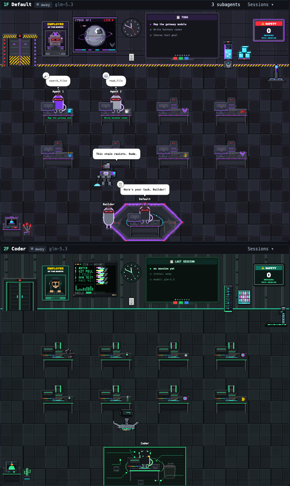

# Hermes Office

**A pixel-art office building for the [Hermes](https://github.com/NousResearch/hermes-agent) desktop app: one floor per agent profile, with live subagents and tool calls.**

Each of your agent profiles gets its own floor, and everything on screen is driven by real gateway data. It's a single-file Hermes Desktop plugin with no build step.

<p align="center"></p>

## What it shows

- **One floor per Hermes profile.** Each floor gets its own theme, wall art, furniture and Employee-of-the-Month portrait.
- **Real activity, never filler.**
  - The status chip (working / idle / away) is computed from the profile's freshest session activity. A two-poll hysteresis stops it flickering.
  - Subagents show up as characters at desks while they run. When they finish, they walk to the elevator and leave.
  - The lead agent's speech bubble shows the tool call it is actually running.
- **Live boards:**
  - a TOOLS pie chart of the session's real tool calls;
  - a SAFETY sign counting messages this session;
  - a TODO / LAST SESSION board.
- **Ambient life that invents no agents.** A cleaner robot wanders each floor, and the wall panels animate. Neither is counted or clickable.
- **Click an agent to open its chat.** The session opens in a new tab beside your current chat.
- **Floor themes** matched to the profile: Mech Base (default), Coder Lab, Design Studio, Writer Room, Production Studio, QA Lab, each with its own cleaner robot and animated props.

## Requirements

- Hermes Desktop with plugin support (plugins load from `~/.hermes/desktop-plugins/`).
- Optional: a git checkout of hermes-agent (default `~/.hermes/hermes-agent`) for the core patch below.

## Install

```bash
git clone https://github.com/MelvernMogens/hermes-office ~/.hermes/desktop-plugins/hermes-office
```

The desktop app hot-loads plugins from `~/.hermes/desktop-plugins/`, so the **Office** tab appears in the left sidebar without a restart. You can turn it off under Settings → Plugins → Hermes Office.

To rename the building, edit `TOWER_NAME` near the top of `plugin.js`.

### Optional: core patch for live subagents and tool bubbles on every floor

Without the patch, the plugin still runs. Floors for other profiles then render from the `profiles.list` snapshot, and only the session you are chatting in shows live subagents. With the patch, every floor gets live data. It adds two read-only RPCs to the gateway:

| RPC | Returns |
|---|---|
| `session.children` | Running or just-ended subagent sessions per profile, with orphaned rows excluded |
| `session.activity` | The newest tool call per recently active session, with root agent and subagents kept apart |

```bash
bash core-patch/reapply.sh            # default target: ~/.hermes/hermes-agent
# then quit Hermes Desktop (Cmd+Q) and reopen it
```

The script is idempotent, and it runs `git apply --check` before touching anything. **Re-run it after every `hermes update`**, because updates can drop local core edits. If upstream has moved and the patch no longer applies, the script changes nothing and says so. The plugin feature-detects both methods: if they are missing, it simply shows 0 subagents for other profiles.

## How it works

```
Hermes Desktop ──host.request──► gateway JSON-RPC
   │                              profiles.list (include_sessions)
   │                              session.active_list, subagent.list
   │                              session.children / session.activity   ← core patch
   ▼
plugin.js (single ESM file: React via the plugin SDK,
           sprites embedded as data URIs, CSS-transition choreography)
```

- **One self-contained file.** `plugin.js` carries all art as data URIs, so there is nothing to fetch at runtime.
- **Polling.** It polls every 2 s while busy and every 8 s at rest, and only for floors that are on screen. Animations pause when the pane is hidden, the window is unfocused, or the floor is off-screen.
- **Uniform scaling.** Rooms are laid out in a fixed 1280×1024 world and scaled uniformly to the pane width, so dragging the divider never reflows the layout.

## Gotchas (each cost a debugging session)

- **The desktop loader regex-scans the whole source.** It matches `from "x"`, `import "x"` and `import("x")` anywhere, comments and strings included. One comment like `opened from "+ New chat"` fails the entire plugin. Run `node test/check_imports.cjs plugin.js` before shipping.
- **The host injects Tailwind preflight** (`img { max-width:100% }`), which collapses absolutely positioned sprites to 0 px. The plugin scopes a reset, and the harness adds the same rule so it matches the host.
- **A dead process leaves `ended_at` NULL forever.** A subagent therefore counts as running only if `ended_at IS NULL` *and* it was active in the last ~10 minutes. Without that check you get ghost agents.

## Development

```bash
python3 -m http.server 8766                     # serve the REPO ROOT (the harness imports ../plugin.js)
open http://127.0.0.1:8766/test/harness.html    # manual: scenario / theme / locale / width switches

# headless full run (needs playwright; CHROME_PATH optional)
npm i -D playwright && npx playwright install chromium-headless-shell
node test/run_headless.cjs full /tmp/office.json # prints pass / fail / console / pageErrors
```

The full scenario takes several minutes, because it waits on real walk and elevator timings.

**Art.** Every theme sprite is drawn in code (Python stdlib only). To regenerate:

```bash
cd themes/tools && python3 gen_themes.py && python3 gen_v56.py
```

The output lands in `themes/sprites/` and `themes/themes.json`. `plugin.js` is the shipped build: the theme sprites and animation frames are already embedded in it as data URIs. The embedding scripts are not part of this repo yet. Licensing details are in `themes/ASSETS-LICENSE.md`.

## Credits

- The room layout, furniture sprites and choreography are a re-creation of **[paulrobello/claude-office](https://github.com/paulrobello/claude-office)** (MIT, © 2026 Paul Robello). Its downsampled sprites are embedded in `plugin.js` and `test/sprites.gen.js`.
- The harness vendors React 18.3.1 (MIT, © Meta Platforms, Inc.).

See [THIRD_PARTY_NOTICES.md](THIRD_PARTY_NOTICES.md).

## Updating

```bash
git -C ~/.hermes/desktop-plugins/hermes-office pull
bash ~/.hermes/desktop-plugins/hermes-office/core-patch/reapply.sh   # after every `hermes update`, if you use the patch
```

## License

[MIT](LICENSE). This is a personal project and is not affiliated with Nous Research. The "Megatron" floor theme is an original design: no Hasbro / Transformers logos or artwork are reproduced.

Built by [Melvern Mogens](https://github.com/MelvernMogens).
